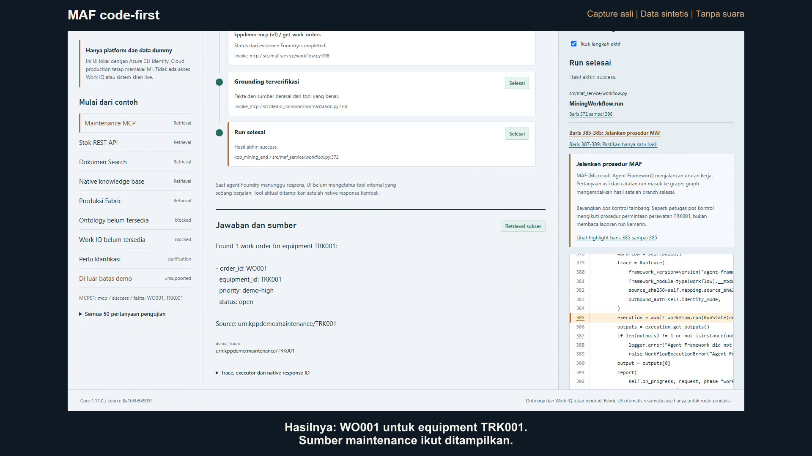
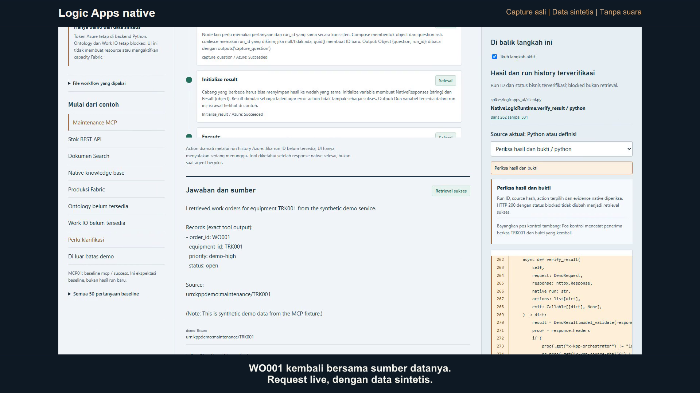
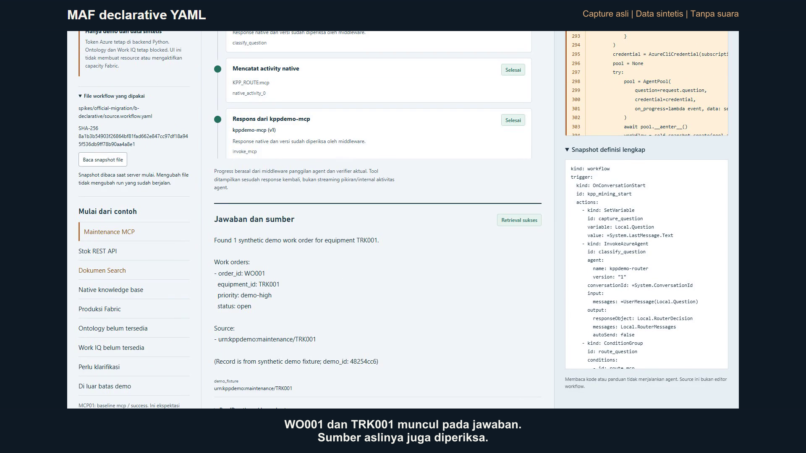
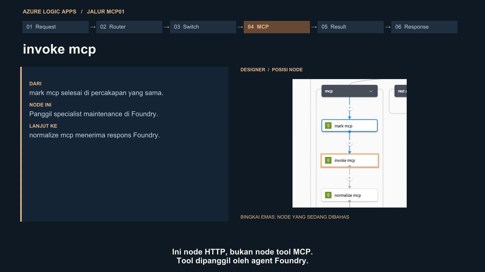

# Demo migrasi workflow AI

Contoh memindahkan pengaturan alur kerja dari workflow Microsoft Foundry ke
**Microsoft Agent Framework (MAF)** atau **Azure Logic Apps**, dengan data
pertambangan sintetis.

Pengguna mengirim pertanyaan, router memilih satu specialist, specialist membaca
data lewat tool, lalu aplikasi memeriksa jawaban dan sumbernya. Yang dipindahkan
adalah **orkestrasi**: aturan siapa dipanggil dan kapan. Agent, model, dan sumber
data tidak otomatis ikut pindah.

## Mulai dari sini

| Kebutuhan | Bacaan |
|---|---|
| Belum mengenal demo ini | [Alur belajar](docs/training/README.md) |
| Ingin menyiapkan salinan lokal | [Persiapan dan batas demo](docs/how-to/setup-and-source.md) |
| Ingin memakai lingkungan Azure sendiri | [Menjalankan di environment sendiri](docs/how-to/run-in-your-environment.md) |
| Ingin memahami pilihan migrasi | [YAML Foundry ke MAF](docs/how-to/foundry-yaml-to-maf-newbie.md) |
| Ingin melihat siapa memanggil siapa | [Arsitektur dan satu alur request](docs/how-to/maf-internals-newbie.md) |
| Ingin menjalankan UI pada lingkungan yang sudah siap | [Panduan UI lokal](docs/how-to/maf-ui.md) |
| Ingin menelusuri semua materi | [Indeks dokumentasi](docs/README.md) |

## Video demo tiga UI

Tiga rekaman terpisah memakai pertanyaan TRK001 yang sama, dengan penjelasan
teks Bahasa Indonesia dan **tanpa suara**. Klik preview untuk membuka MP4.

| MAF code-first | Logic Apps native | MAF declarative YAML |
|---|---|---|
| [](docs/videos/maf.mp4) | [](docs/videos/logicapps.mp4) | [](docs/videos/declarative.mp4) |

Rekaman menunjukkan input, proses, jawaban/sumber, source inspector, dan trace.
Bagian waktu tunggu yang dipercepat diberi label. Ini satu kasus MCP01 per UI,
bukan bukti full50 atau benchmark kecepatan.

**Logic Apps Designer — jalur MCP (2:13)**

[](docs/videos/logicapps-mcp-designer.mp4)

Lihat kotak node dan panahnya dulu, lalu buka **Parameters** untuk mengikuti data
dari pertanyaan **TRK001** sampai jawaban **WO001** pada run yang sama.
[Lihat bab dan timestamp](docs/videos/README.md#4-logic-apps-designer-satu-jalur-mcp).

[Daftar video, subtitle, dan cara memasang player GitHub](docs/videos/README.md).

## Pilihan jalur

| Jalur | Yang menjalankan alur | Batas penting |
|---|---|---|
| Foundry source | Workflow native Foundry | Definisi sumber dan acuan perilaku demo. |
| MAF baseline | Graph Python `WorkflowBuilder` | Target YAML adalah konfigurasi turunan, bukan otomatis official YAML loader. |
| MAF declarative / Cara 1 | Loader YAML resmi pada eksperimen terpisah | Environment dan cakupan pengujiannya berbeda dari baseline. |
| Logic Apps | Workflow native Azure | Python membantu gateway/normalisasi; bukan pengganti routing Logic Apps. |

Jalur-jalur tersebut adalah **alternatif**, bukan urutan Foundry -> MAF ->
Logic Apps dalam satu request. Pada implementasi demo, router dan specialist
masih berjalan di Foundry.

## Satu contoh

Pertanyaan:

```text
Show work orders for equipment TRK001.
```

Ketika lingkungan demo siap, hasil yang diharapkan adalah route `mcp`, work order
`WO001` untuk `TRK001`, dan sumber maintenance sintetis yang sesuai. Ini contoh
hasil yang diharapkan, bukan bukti bahwa retrieval baru saja dijalankan.

Lihat [katalog prompt](docs/how-to/test-prompts.md) untuk contoh route lain,
termasuk `blocked`, `clarification`, dan `unsupported`.

## Isi repository

- [docs](docs/README.md): panduan publik, alur belajar, referensi, dan roadmap.
- [src](src): implementasi layanan, orkestrasi, dan UI utama.
- [source](source), [migration](migration), dan [targets](targets): sumber alur,
  mapping, serta target hasil konversi.
- [contracts](contracts) dan [data](data/seed): kontrak API serta data sintetis.
- [tests](tests): pengujian dan corpus contoh.
- [infra](infra), [tools](tools), dan [spikes](spikes): template infrastruktur,
  alat bantu, serta eksperimen yang terpisah dari baseline.

Lihat [peta repository](docs/reference/repository-map.md) untuk tanggung jawab
tiap folder.

## Batas versi publik

- Dokumentasi utama memakai Markdown agar bisa dibaca langsung di GitHub.
- Konfigurasi lingkungan, bukti mentah, catatan operator, dan workshop HTML lama
  beserta screenshot/generator-nya tetap lokal. File aslinya tidak dihapus.
- Salinan publik **bukan installer Azure sekali jalan**. UI live dan beberapa
  tes live memerlukan konfigurasi, baseline, izin, serta layanan demo yang disiapkan
  operator. Lihat [persiapan](docs/how-to/setup-and-source.md).
- Source aplikasi tetap disertakan. Tes unit/contract memakai fixture sintetis
  dan bisa dijalankan tanpa file env atau bukti operator. Runtime utama mendukung
  profil lingkungan sendiri; detailnya ada di [panduan environment](docs/how-to/run-in-your-environment.md).
- Ontology Fabric IQ dan sandbox Work IQ merupakan batas kemampuan pada snapshot
  demo, bukan hasil retrieval yang boleh dianggap sukses.
- Request live dapat menambah biaya. Membaca Markdown tidak menjalankan layanan.

## Pengembangan dan publikasi

Mulai dari [panduan kontribusi dan publikasi](CONTRIBUTING.md). File lokal
dipisahkan melalui [.gitignore](.gitignore); pemisahan ini bukan pengganti
pemeriksaan isi kode, riwayat Git, izin penggunaan materi, atau lisensi.

Sebelum staging/push, jalankan [pemeriksaan publikasi](tools/check_publication.py)
dengan Gitleaks terpasang:

```powershell
.\.venv\Scripts\python.exe .\tools\check_publication.py
```

Pemeriksaan membaca kandidat publik dan isi index Git tanpa mengubah file lokal.
Nama resource, endpoint, dan identifier non-secret pada snapshot demo tetap
disertakan; token, key asli, credential, dan file env tidak boleh ikut.
