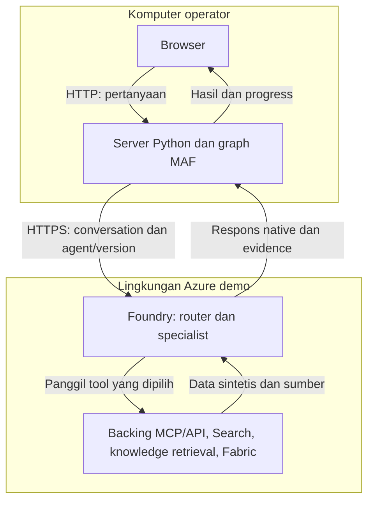
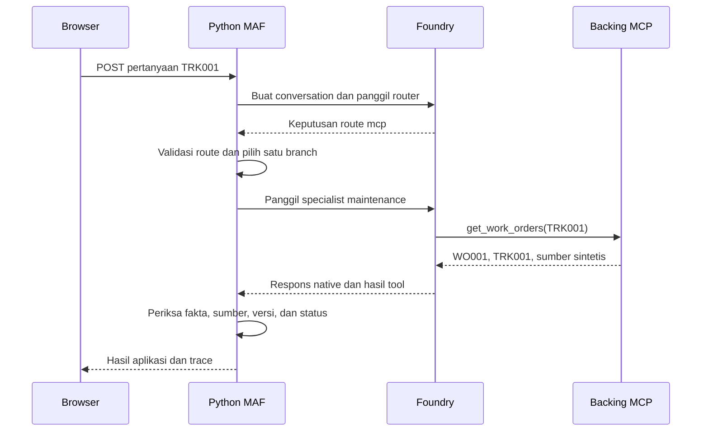

# Cara kerja MAF: dari browser sampai sumber data

[Indeks dokumentasi](../README.md) / [Panduan](README.md)

Pengguna menanyakan work order `TRK001`. Browser mengirim pertanyaan ke server
Python yang sudah hidup. MAF memilih specialist melalui router Foundry,
specialist membaca `WO001` melalui MCP, lalu hasil terverifikasi kembali ke UI.

## Kenali komponennya

| Komponen | Tugas |
|---|---|
| Browser / UI | Menerima pertanyaan dan menampilkan progress, jawaban, serta sumber. |
| Server Python | Menyediakan HTTP API dan menjalankan graph MAF. |
| Workflow / graph | Menentukan urutan langkah dan branch yang boleh dipilih. |
| Router | Agent yang memilih route; bukan pengambil semua data. |
| Specialist | Agent untuk satu bidang yang memakai tool sesuai tugasnya. |
| MCP | Model Context Protocol, cara agent menemukan dan memanggil tool. |
| Normalizer | Memeriksa evidence native lalu membentuk hasil sesuai kontrak aplikasi. |
| Trace | Catatan langkah dan ID untuk menelusuri run, bukan pikiran internal model. |

## Arsitektur

Diagram ini menggambarkan jalur UI MAF lokal. Pada mode hosted, API Python dapat
berjalan di App Service, dengan identity dan batas aksesnya sendiri.
**MAF tidak menggantikan Foundry specialist atau data service pada demo ini.**

Logic Apps adalah alternatif: workflow native Azure mengatur panggilan.
Endpoint normalisasi Python tidak boleh mengambil alih routing-nya. Foundry
source juga merupakan jalur pembanding, bukan workflow yang dipanggil diam-diam
oleh target MAF.

## Persiapan berbeda dari request

Saat startup, aplikasi memuat konfigurasi/mapping, menyiapkan dependency dan
menyediakan endpoint lokal. Browser baru dapat terhubung setelah server hidup.
Startup bukan pertanyaan pengguna dan tidak membuktikan data bisa diambil.

Pada eksperimen declarative, loader membaca snapshot YAML saat startup.
Pada baseline, graph dibangun dari mapping yang divalidasi. Keduanya tidak boleh
disamakan hanya karena sama-sama mempunyai file YAML.

## Satu request sampai pulang

Diagram menjelaskan urutan, bukan bukti run baru atau streaming tool internal.
Detail transport serta state dipisahkan pada tabel berikut.

| Sambungan | Input | Output dan pemakai berikutnya |
|---|---|---|
| Browser -> Python, HTTP lokal | Pertanyaan pengguna | Request tervalidasi dan ID run untuk graph. |
| Python -> router Foundry, HTTPS | Pertanyaan dan conversation | JSON route; Python memvalidasi sebelum dispatch. |
| Python -> specialist Foundry, HTTPS | Agent/version, konteks, dan pertanyaan asli | Specialist menjalankan tool yang diizinkan. |
| Specialist -> MCP | Equipment ID `TRK001` | Record `WO001` dan sumber; dipakai specialist. |
| Foundry -> Python | Respons native beserta evidence | Normalizer memeriksa fakta serta sumber. |
| Python -> browser | Hasil sesuai kontrak dan event yang benar-benar diamati | UI menampilkan jawaban, status, sumber, serta trace. |

Token Azure tetap di backend dan tidak diberikan ke browser. Identity Azure CLI
lokal berbeda dari MI aplikasi hosted. Role pada management plane juga tidak
otomatis memberi izin memanggil setiap endpoint runtime.

## Mulai membaca kode dari mana?

| File | Yang dicari |
|---|---|
| [Launcher](../../tools/run_maf_ui.py) | Startup, port loopback, dan shutdown UI. |
| [Backend UI](../../src/maf_service/demo_ui.py) | Request browser, event, source inspector, dan gateway Foundry. |
| [Workflow](../../src/maf_service/workflow.py) | Graph, route, specialist, dan hasil tanpa dispatch. |
| [Transport Foundry](../../src/demo_common/foundry.py) | Conversation, activity, dan invocation agent. |
| [Normalizer](../../src/demo_common/normalization.py) | Validasi tool evidence, fakta, dan sumber. |
| [Backing service](../../src/backing_service/app.py) | API/MCP yang membaca seed sintetis. |
| [Kontrak JSON](../../contracts/demo.schema.json) | Bentuk request dan hasil yang harus dipenuhi. |

Gunakan nama fungsi/simbol di editor, bukan nomor baris dari screenshot lama.

## Hasil sukses dan bukan sukses

- `success`: route data mengembalikan fakta dan sumber yang lolos pemeriksaan.
- `blocked`: capability yang diperlukan belum tersedia.
- `clarification`: pertanyaan perlu dipersempit sebelum specialist dipanggil.
- `unsupported`: permintaan di luar cakupan atau melanggar batas read-only.
- `failed`: proses/dependency/evidence gagal; bukan jawaban fallback sukses.

Status non-dispatch tidak boleh memanggil specialist untuk membuat hasil terlihat
lengkap. Progress hanya menunjukkan batas eksekusi yang diamati kode; tool native
baru boleh ditampilkan setelah responsnya memang diterima.

**Berikutnya:** [jalankan UI jika lingkungan siap](maf-ui.md), atau pelajari
[cara membaca bukti pengujian](../reference/validation.md).
