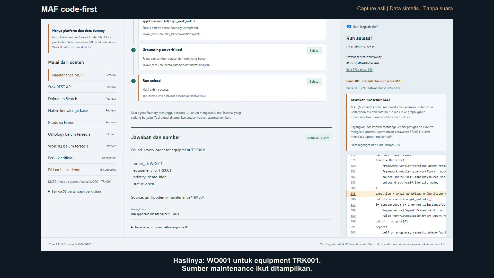
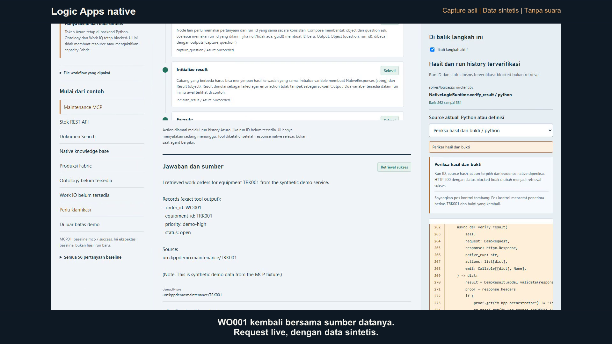
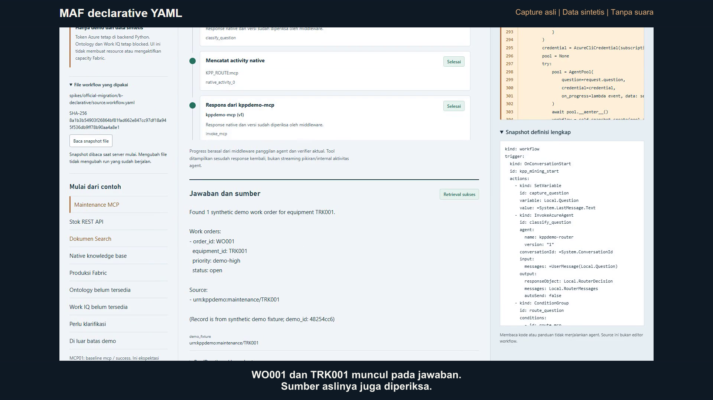
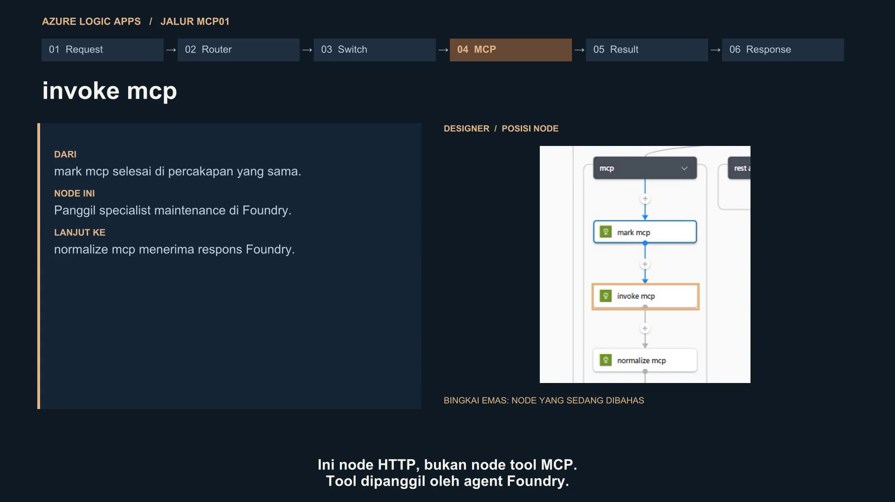

# Video demo migrasi workflow

[Beranda](../../README.md) | [Indeks dokumentasi](../README.md)

Setiap video mengikuti satu pertanyaan sampai jawabannya kembali:

```text
Show work orders for equipment TRK001.
```

Video memakai **capture browser yang sebenarnya**, dengan penjelasan teks
Bahasa Indonesia yang menyatu di gambar. Tidak ada narasi suara atau musik.
Hasil yang direkam adalah work order `WO001`, equipment `TRK001`, dan sumber
maintenance sintetis yang lolos pemeriksaan.

## 1. MAF code-first

[](maf.mp4)

[Buka MP4](maf.mp4) | [Subtitle SRT](maf.srt) |
[Workshop MAF code-first](https://sandy-gunawan.github.io/migrationworkflow/workshop/maf-code-first-walkthrough.html)

Python MAF menjalankan graph, memilih branch dari keputusan router, memanggil
specialist, lalu memeriksa evidence. Video juga membuka kode langkah dan trace.

## 2. Logic Apps native

[](logicapps.mp4)

[Buka MP4](logicapps.mp4) | [Subtitle SRT](logicapps.srt) |
[Workshop UI Logic Apps](https://sandy-gunawan.github.io/migrationworkflow/workshop/logicapps-ui-walkthrough.html)

Orkestrasi berlangsung di workflow native Azure. Python lokal menjadi gateway
dan pengamat; normalizer tidak mengambil alih pemilihan branch.
Video memperlihatkan definisi JSON dan korelasi run native.

## 3. MAF declarative YAML

[](declarative.mp4)

[Buka MP4](declarative.mp4) | [Subtitle SRT](declarative.srt) |
[Workshop MAF workflow YAML](https://sandy-gunawan.github.io/migrationworkflow/workshop/maf-declarative-walkthrough.html)

YAML tetap menjadi file terpisah. Loader resmi membacanya saat startup,
lalu membuat workflow untuk request yang masuk. Agent dan model tetap Foundry.
Video membuka snapshot YAML sebelum menjalankan pertanyaan.

<a name="5-logic-apps-designer-satu-jalur-mcp"></a>

## 4. Logic Apps Designer: satu jalur MCP

[](logicapps-mcp-designer.mp4)

[Buka MP4 — 2:13](logicapps-mcp-designer.mp4) | [Subtitle SRT](logicapps-mcp-designer.srt) |
[Workshop node dan parameter Logic Apps](https://sandy-gunawan.github.io/migrationworkflow/workshop/logicapps-node-walkthrough.html)

Mulai dari **Development Tools → Logic app designer**. Untuk tiap langkah,
lihat dulu **kotak node yang dibingkai emas**, panah, dan node tetangganya.
Baru setelah itu buka **Parameters** untuk melihat asal data, nilai yang
diteruskan, siapa yang memakainya, dan kenapa. Peta kecil di atas layar
menunjukkan posisi kita dari **Request** sampai **Response**.

| Waktu | Langkah | Parameter dan nilai yang perlu dicek |
|---|---|---|
| 0:07 | `kpp mining start` → `Validate request` → `capture question` | `POST` membawa `question` dan boleh membawa `run_id`. Parse JSON memeriksa Body sebelum agent dipanggil. Compose menyimpan pertanyaan asli dan ID untuk mencocokkan input dengan hasil. |
| 0:33 | `create conversation` → `classify question` | Pertanyaan asli menjadi pesan user. Router `kppdemo-router:1` menerima pertanyaan dan ID percakapan; keputusan yang sudah diparse berisi `route: mcp`. |
| 0:51 | `route question` → `mark mcp` | `On` membaca `route` dari `router_decision`. Nilai `mcp` cocok dengan case `mcp`. `mark mcp` menulis `KPP_ROUTE:mcp` pada konteks yang sama sebelum specialist dipanggil. |
| 1:08 | `invoke mcp` | Node terlihat di antara `mark mcp` dan `normalize mcp`. `POST /openai/v1/responses` membawa pertanyaan asli, ID percakapan, dan `agent_reference` `kppdemo-mcp:1`. Managed identity memakai audience `https://ai.azure.com`. |
| 1:24 | Bukti panggilan tool | **Agent Foundry**, bukan Logic Apps langsung, memanggil `get_work_orders` dengan `equipment_id: TRK001`. Respons tool cocok dengan `WO001`. |
| 1:30 | `normalize mcp` → `set result mcp` | Normalizer menerima `run_id`, `route: mcp`, dan Body dari `invoke_mcp` untuk memeriksa fakta serta sumber. Setelah ID respons dicatat, hasil disimpan di `Result` agar node Response bisa membacanya. |
| 1:47 | `kpp mining end` | Node Response berada di luar scope `Execute`. **Body** mengambil `Result`, lalu mengembalikan status dan data ke client. |
| 1:56 | **Run history** | Di **Parameters → Inputs → Body** run yang sama, periksa `status: success`, `WO001`, dan `urn:kppdemo:maintenance/TRK001`. |

Cuplikan **Designer** menunjukkan konfigurasi. **Run history** dan ringkasan
respons native menunjukkan apa yang benar-benar terjadi pada run MCP01 yang
sudah diverifikasi sebelumnya. Tidak ada trigger, perubahan, atau publish baru.

### Catatan tes manual di Azure Portal

Pada demo ini, **Run with payload** tanpa OAuth mendapat **HTTP 401** sebelum
workflow berjalan. Run yang terlihat di video berasal dari `POST` berizin ke
trigger yang sama, bukan tombol portal. [Helper POST](../../tools/azure_job.py)
menunjukkan pola `logic_request`. Saat mencoba di sandbox sendiri, kirim
pertanyaan sebagai JSON di **Body**, gunakan identitas berizin, lalu cocokkan
`x-ms-workflow-run-id` dari respons dengan **Run history**. Jangan menyalakan
SAS atau menyalin token ke portal, dokumentasi, atau rekaman.

## Cara membaca rekamannya

- Masing-masing video mengikuti **satu run live MCP01** dengan data sintetis.
- Jawaban bukan replay fixture; sumber maintenance ikut diperiksa.
- Waktu tunggu bisa dipercepat pada tiga video UI atau dipotong pada cuplikan
  portal. Jangan memakai durasi video sebagai latency layanan.
- Rekaman bukan uji ulang 50 kasus, bukan perbandingan performa, dan bukan
  bukti route Fabric, ontology, atau Work IQ.
- Tidak ada kapasitas Fabric yang perlu diaktifkan untuk kasus ini.
- Yang direkam hanya halaman UI, bukan terminal, file env, browser profile
  pribadi, atau desktop operator.

[Hasil pemeriksaan media](verification.json) dan
[timeline](../../tools/video-capture/public/timeline.json) mencakup tiga video UI.
MP4 Designer diperiksa terpisah: H.264, 1080p, 25 FPS, tanpa suara,
dan di bawah 10 MB.

## Memasang di GitHub

Preview pada README memakai tautan relatif ke MP4. Jika GitHub menampilkan
halaman file/download, pilih raw/download untuk memutar videonya.

Untuk memperoleh URL attachment dan player GitHub:

1. Setelah repository dibuat, buka kotak komentar issue atau pull request.
2. Tarik satu MP4 ke kotak komentar; **file langsung terunggah**.
3. Salin URL attachment yang dibuat, lalu gunakan pada bagian video README.
4. Ulangi untuk video lainnya. Jangan memakai URL lokal komputer.

Ini langkah manual setelah review, bukan upload yang sudah dilakukan otomatis.
Subtitle sudah terbakar di video; GitHub tidak perlu memuat SRT secara terpisah.
SRT disediakan untuk pengeditan atau player lain yang mendukungnya.

Format memakai H.264 untuk kompatibilitas browser. Setiap MP4 akhir diperiksa
agar lebih kecil dari 10.000.000 byte, mengikuti batas konservatif upload video
GitHub Free. Lihat [aturan attachment resmi GitHub](https://docs.github.com/en/get-started/writing-on-github/working-with-advanced-formatting/attaching-files).

## Mengedit ulang tanpa Azure

[Source editor video](../../tools/video-capture/README.md) memakai Playwright
untuk title card dan FFmpeg untuk potongan capture, label waktu, serta subtitle.
Capture sumber yang sudah dioptimalkan untuk tiga UI ikut disertakan agar
ketiganya bisa dirender ulang **tanpa** menjalankan request Azure lagi.
Untuk Designer, yang disertakan hanya MP4 akhir, preview, dan subtitle;
capture mentah serta catatan operator tidak ikut publikasi.
